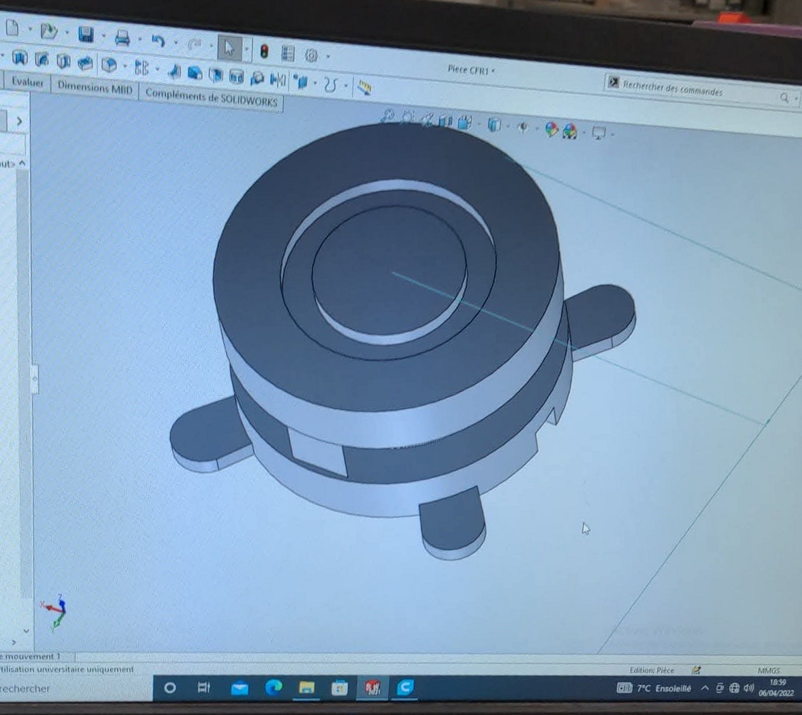

# Eurobot 2022: Autonomous Robot (Mechanical Design, Embedded Code and Motion)

Contribution to the autonomous robot of the **Centrale Marseille** first-year student team at the
**French Robotics Cup (Eurobot 2022)**, a competition where fully autonomous robots complete
scoring tasks against an opponent within a time-limited match.

📄 [Official Eurobot 2022 rules (EN)](https://www.coupederobotique.fr/wp-content/uploads/Eurobot2022_Rules-EN.pdf)

## Challenge

In the 2022 edition (theme: archaeology), each team had to build a robot able to:

- collect the team's **statuette** from its pedestal,
- place it in a **display cabinet** that lights up when the statuette is deposited,
- swap it with the official **replica** (a wooden cube) on the pedestal,
- **avoid the opposing robot** throughout, since an avoidance system is mandatory.

Teams also design and build their own statuette and display cabinet.

## My contributions

| Area | What I did |
|---|---|
| **Mechanical design (SolidWorks)** | Designed the statuette, the display cabinet (deposit zone) and the Lidar cover |
| **Electromechanical design** | Designed the statuette so that it closes an electrical circuit on contact and lights several LEDs on the display cabinet |
| **Embedded software** | Wrote the Arduino code in C++ so the robot could fetch the statuette, deposit it and avoid the opponent |
| **Motion** | Contributed to the movement calculation using the wheel encoders, and measured how much the wheels slipped |

The Lidar and wheel-encoder integration was handled by other team members. I worked with their
outputs in the code.

## Design details

### Statuette and display cabinet
Both were modeled in SolidWorks to the dimensional limits in the rules. On deposit, the statuette
closes an electrical circuit that powers LEDs on the cabinet, which satisfies the rule requiring a
luminous element activated by the statuette being placed.

### Lidar cover
The Lidar position inherited from the earlier work of second-year students did not account for the
height limit in the rules. When the team discovered the constraint, I designed a 3D-printed cover
to raise the Lidar to the required height. It leaves **windows** in its walls, so the sensor can
still detect the opposing robot and the game elements.

*SolidWorks model of the Lidar cover. The windows keep the Lidar's field of view open.*

## Motion and navigation

- **Odometry:** wheel encoders estimate the robot's position from wheel rotation.
- **Challenge, wheel slip:** the team had not anticipated that the robot would **slip sideways** on
  the playing surface. Encoder readings then no longer matched the real motion, and the calculated
  position drifted from the true one. I measured how much the wheels slipped and contributed to the
  movement calculation to account for it.
- **Obstacle avoidance:** Lidar data lets the robot detect and avoid the opponent, as the rules require.
- **Software:** Arduino controller programmed in **C++**.

**Outcome:** the robot could move between the statuette, the display cabinet and the pedestal,
complete its task cycle, and avoid the opposing robot.

## Solutions explored

**Localization with ArUco markers.** We studied locating the robot by reading the black-and-white
ArUco markers placed on the playing area, to correct the drift caused by slip. We eventually gave up
on this approach. [Add the reason if you remember it, for example complexity, time or hardware.]

## What I learned

- A design constraint found late can force a redesign. Reading the rules early would have avoided
  rework on the Lidar cover.
- A theoretical model is not enough. Wheel slip showed that encoder-based odometry has to be
  validated against measurements on the real surface.
- Studying a solution and choosing to drop it is also an engineering decision.

## Tools and skills

SolidWorks · 3D printing · Arduino · C++ · wheel encoders and odometry · electromechanical design

## Team

Centrale Marseille first-year students, Eurobot 2022.
